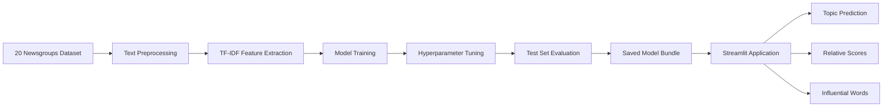

 <div align="center">

# 📄 DocClassify AI

### Intelligent Document Classification System

*An end-to-end NLP project that transforms raw text into meaningful topic predictions.*

<p>
  
  
  
  
</p>

<p>
  
  
  
</p>

**[🚀 Live Demo](https://docclassify-ai.onrender.com)** · **[📓 Training Notebook](./Kaushikee_Karmakar_Project1_Document_Classification.ipynb)** · **[📑 Project Report](./Kaushikee_Karmakar_Project1_Report.pdf)**

</div>

---

## 🎯 Overview

**DocClassify AI** is a Natural Language Processing (NLP) project that classifies text into one of six predefined topics using machine learning.

The system combines TF-IDF feature extraction with a tuned Linear Support Vector Machine (SVM) to predict document categories, display the top three predictions with relative confidence scores, and highlight words that contribute positively to the selected category.

Developed as **Project 1 of the SparkIIT AI Training and Internship Program, powered by Wipro DICE ID**, this project demonstrates the end-to-end machine learning workflow, from dataset preparation and model optimization to evaluation and web application deployment.

### ✨ Key features

- 📝 Classify user-provided text into six topics.
- 🎯 View the top three predicted categories and their relative scores.
- 🔎 Inspect influential words behind a prediction.
- 📊 Explore model comparisons and evaluation metrics.
- 🧪 Compare traditional TF-IDF models with a sentence-embedding baseline.
- 🌐 Access the classifier through a Streamlit web interface.

### 💡 Potential applications

The underlying approach can be adapted for document organization, news categorization, email routing and customer support ticket classification. These are potential applications rather than features implemented in this project.

---

## 📦 Dataset

The project uses the **20 Newsgroups dataset**, available through scikit-learn, restricted to six categories.

| Dataset category | Topic |
|---|---|
| `comp.graphics` | Computer graphics |
| `rec.autos` | Cars and automobiles |
| `rec.sport.hockey` | Hockey |
| `sci.med` | Medicine |
| `sci.space` | Space |
| `talk.politics.guns` | Gun politics |

The reported experiment uses 5,668 documents, with 1,131 held out for testing.

The preprocessing workflow removes headers, footers and quoted material, then cleans the text before feature extraction.

**Dataset limitation:** These are historical Usenet discussion posts, primarily from the 1990s. Performance on modern documents and unrelated domains has not been established.

---

## 🔄 Machine Learning Pipeline



### Pipeline stages

1. **Data preparation:** Select six categories and clean the text.
2. **Text preprocessing:** Lowercase, tokenize, remove stop words and retain alphabetic tokens.
3. **Feature extraction:** Represent text using TF-IDF features with unigrams and bigrams.
4. **Model development:** Compare Multinomial Naive Bayes, Logistic Regression and Linear SVM.
5. **Optimization:** Tune the Linear SVM using GridSearchCV.
6. **Evaluation:** Measure accuracy, precision, recall and F1-score, and inspect category-level errors.
7. **Deployment:** Load the saved model bundle into a Streamlit application.

The vectorizer is fitted on the training data rather than the test data to avoid test-set leakage.

---

## 🏆 Model Evaluation

The following are the reported results for the 1,131-document test set.

### Model comparison

| Model | Accuracy | Weighted precision | Weighted recall | Weighted F1 |
|---|---:|---:|---:|---:|
| Naive Bayes | 90.45% | 0.9058 | 0.9045 | 0.9044 |
| Logistic Regression | 89.74% | 0.8977 | 0.8974 | 0.8974 |
| Linear SVM | 90.89% | 0.9090 | 0.9089 | 0.9088 |
| **Tuned Linear SVM (C = 0.5)** | **91.07%** | **0.9108** | **0.9107** | **0.9105** |
| MiniLM embeddings + Logistic Regression | 89.30% | Not reported | 0.8930 | 0.8930 |

*Precision, recall and F1-score are reported as support-weighted averages, except where a metric is unavailable.*

### Per-category performance

| Category | Precision | Recall | F1-score | Support |
|---|---:|---:|---:|---:|
| `comp.graphics` | 0.905 | 0.953 | 0.928 | 190 |
| `rec.autos` | 0.904 | 0.909 | 0.907 | 187 |
| `rec.sport.hockey` | 0.948 | 0.943 | 0.946 | 194 |
| `sci.med` | 0.893 | 0.911 | 0.902 | 192 |
| `sci.space` | 0.903 | 0.880 | 0.891 | 191 |
| `talk.politics.guns` | 0.911 | 0.864 | 0.887 | 177 |

### 🔍 Key findings

- **TF-IDF performed strongly:** The tuned Linear SVM achieved a reported test accuracy of 91.07%.
- **The traditional models performed similarly:** Their accuracy differences are relatively small, so the results do not establish that one model will always be superior.
- **The embedding baseline did not outperform TF-IDF:** MiniLM embeddings with Logistic Regression achieved 89.30% accuracy in the reported experiment.
- **Gun politics was the most challenging category by recall:** Its recall was 0.864, indicating that some documents from this category were assigned to other classes.
- **Dataset-specific vocabulary matters:** Words associated with historical discussions can influence predictions, potentially limiting generalization to contemporary text.

These findings describe the evaluated dataset and split; they should not be interpreted as guaranteed performance on unseen real-world document collections.

---

## 🖥️ Streamlit Application

The application provides three tabs.

### 🔍 Classify

- Enter or paste text into the input area.
- Try built-in examples covering the six supported topics.
- View the predicted category.
- Inspect the top three category scores.
- See words that positively contribute to the selected category.

### 📊 Model performance

- View test accuracy and weighted F1-score.
- Inspect the number of test documents and supported categories.
- Compare the evaluated models.
- Explore per-category precision, recall and F1-score.
- Inspect the confusion matrix.

### ℹ️ About

Review the model workflow and its main limitations.

**Important:** The displayed scores are calculated by applying a softmax transformation to SVM decision scores. They represent relative scores, not calibrated probabilities that a prediction is correct.

---

## 🗂️ Repository Structure

```text
Document-Classification-AI/
├── app.py
├── doc_classifier.joblib
├── requirements.txt
├── Kaushikee_Karmakar_Project1_Document_Classification.ipynb
├── Kaushikee_Karmakar_Project1_Report.pdf
├── .streamlit/
│   └── config.toml
├── assets/
└── README.md
```

| File or directory | Purpose |
|---|---|
| `app.py` | Streamlit application and prediction interface |
| `doc_classifier.joblib` | Saved TF-IDF vectorizer and trained classifier |
| `requirements.txt` | Python package dependencies |
| `Kaushikee_Karmakar_Project1_Document_Classification.ipynb` | Training, experimentation and evaluation notebook |
| `Kaushikee_Karmakar_Project1_Report.pdf` | Project report |
| `.streamlit/config.toml` | Streamlit configuration |
| `assets/` | Repository assets, where applicable |

---

## ⚙️ Run Locally

### 1. Clone the repository

```bash
git clone https://github.com/KK-Dev0/Document-Classification-AI.git
cd Document-Classification-AI
```

### 2. Create a virtual environment

```bash
python -m venv .venv
```

Activate it on Windows PowerShell:

```powershell
.\.venv\Scripts\Activate.ps1
```

On macOS or Linux:

```bash
source .venv/bin/activate
```

### 3. Install dependencies

```bash
python -m pip install -r requirements.txt
```

### 4. Run the application

```bash
python -m streamlit run app.py
```

Open the local URL printed by Streamlit in your terminal.

### ⚠️ Model compatibility

The saved `.joblib` model must be loaded with compatible versions of scikit-learn and its related dependencies. If loading fails, check the environment used to train the model and the versions declared in `requirements.txt`.

Do not upgrade scikit-learn blindly without checking model compatibility.

---

## ☁️ Deployment

The project is configured for a Streamlit application hosted on Render.

**Typical Render configuration**

| Setting | Value |
|---|---|
| Service type | Web Service |
| Build command | `pip install -r requirements.txt` |
| Start command | `streamlit run app.py --server.port $PORT --server.address 0.0.0.0 --server.headless true` |

Set the Python runtime version using the supported Render configuration for the service, and keep the dependency versions compatible with the saved model.

The live demo link is provided above. Its current availability and deployment health should be checked independently.

---

## 🧰 Tech Stack

| Area | Technologies |
|---|---|
| Programming language | Python |
| Machine learning | scikit-learn |
| NLP and feature engineering | TF-IDF, text preprocessing, stop-word removal |
| Classification algorithms | Naive Bayes, Logistic Regression, Linear SVM |
| Embedding baseline | MiniLM sentence embeddings |
| Data processing | NumPy, pandas |
| Visualization | Streamlit, Matplotlib, Seaborn where used in the analysis |
| Model persistence | Joblib |
| Web application | Streamlit |
| Hosting | Render |
| Version control | Git, GitHub |
| Experimentation | Jupyter Notebook, Google Colab |

---

## ⚠️ Limitations and Future Work

- **Limited categories:** The classifier supports only six predefined topics and assigns an input to one of them.
- **Historical training data:** Contemporary language, new terminology and domain shifts may reduce performance.
- **Single reported test split:** Cross-validation and repeated experiments could provide a more robust estimate of generalization.
- **Uncalibrated scores:** The softmax-transformed SVM scores are not calibrated probabilities.
- **Limited semantic understanding:** TF-IDF relies on word and phrase features and does not fully capture context or meaning.
- **External validation:** Performance on modern, independently collected documents has not been established.

### Possible future improvements

- Add an unknown-topic or out-of-distribution rejection mechanism.
- Evaluate on contemporary, independently collected documents.
- Test cross-validation and probability calibration.
- Explore transformer-based classifiers and more extensive embedding experiments.
- Expand the supported categories and improve error analysis.

These are proposed improvements, not claims about currently implemented functionality.

---

## 👩‍💻 Author

**Kaushikee Karmakar**  
BCA Student · Asansol Engineering College

GitHub: [@KK-Dev0](https://github.com/KK-Dev0)

---

## 🙏 Acknowledgments

- **SparkIIT** and **Wipro DICE ID** for the AI training and internship program.
- The **20 Newsgroups** dataset and scikit-learn.
- The scikit-learn, Streamlit and sentence-transformers open-source communities.

---

<div align="center">

⭐ If you find this project useful, consider starring the repository!

</div>
