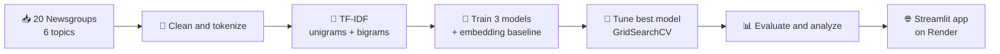
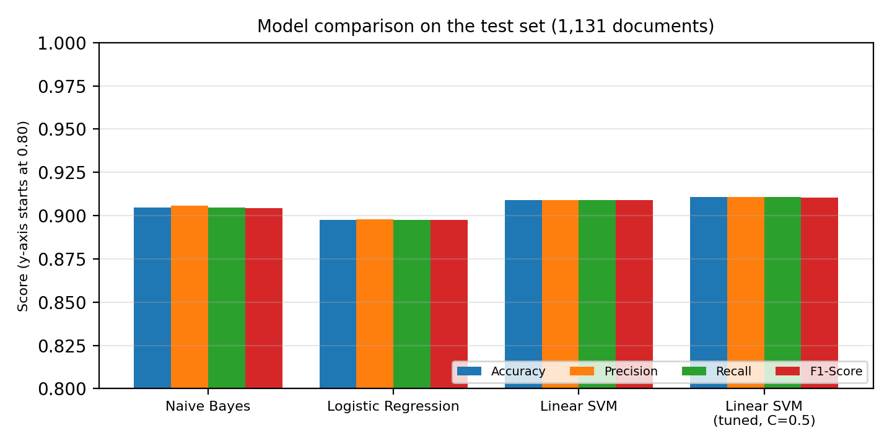
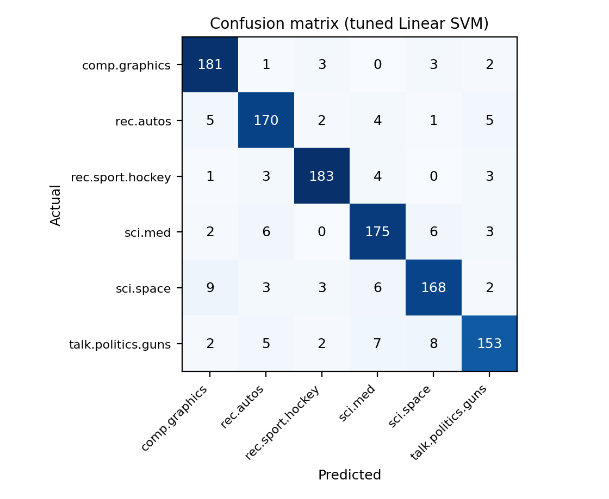
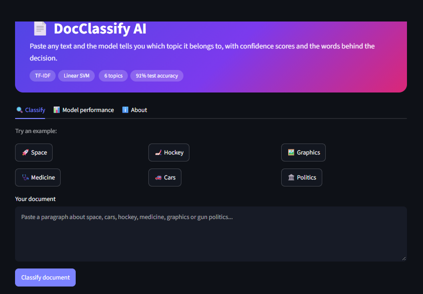
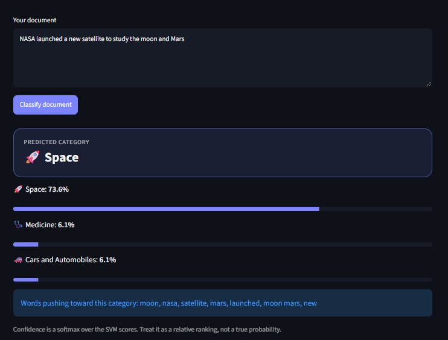

[README (1).md](https://github.com/user-attachments/files/33280279/README.1.md)
<div align="center">

# 📄 DocClassify AI
### Intelligent Document Classification System

*An end-to-end NLP project: raw text in, topic prediction out, deployed as a web app.*

<p>
  
  
  
  
</p>
<p>
  
  
  
</p>

**[🚀 Live Demo](https://docclassify-ai.onrender.com)** &nbsp;|&nbsp; **[📓 Notebook](./Project1_Document_Classification.ipynb)** &nbsp;|&nbsp; **[📑 Full Report (PDF)](./Project1_Report_Document_Classification.pdf)**

</div>

---

## 🎯 Overview

DocClassify AI reads a piece of text and predicts which topic it belongs to: space, hockey, medicine, cars, computer graphics or gun politics. It shows a confidence score for each topic and highlights the words that pushed the model toward its answer.

This project was built for the **SparkIIT AI Training and Internship Program (powered by Wipro DICE ID)** and covers the full machine learning workflow: data collection, text preprocessing, feature extraction, model development, evaluation, optimization, error analysis and deployment.

**Real-world uses of the same approach:** routing customer support tickets, organizing news feeds, triaging emails and sorting documents by topic.

---

## ✅ SparkIIT Brief Coverage

| Task from the project brief | How it was done |
|---|---|
| Collect and preprocess document datasets | 20 Newsgroups corpus, 6 categories, empty documents removed, headers/footers/quotes stripped |
| Text cleaning, tokenization, feature extraction | Lowercasing, letters-only tokenization, stop-word removal, TF-IDF with unigrams and bigrams |
| Develop an AI-based classification model | Naive Bayes, Logistic Regression and Linear SVM, plus a sentence-embedding baseline |
| Train and test the model | Stratified 80/20 split, vectorizer fitted on training data only (no data leakage) |
| Evaluate with Accuracy, Precision, Recall, F1 | Overall and per-category metrics, confusion matrix |
| Analyze results and optimize | GridSearchCV tuning, confusion analysis, most influential words per category |

---

## 📦 Dataset

**20 Newsgroups** (Usenet discussion posts, built into scikit-learn), limited to 6 categories:

`comp.graphics` · `rec.autos` · `rec.sport.hockey` · `sci.med` · `sci.space` · `talk.politics.guns`

- **5,668 documents**, roughly balanced (about 880 to 970 per class)
- Short posts: median 85 words, mean 185 words
- **1,131 documents** held out for testing

---

## 🔄 Pipeline



---

## 🏆 Results

### Model comparison (test set, 1,131 documents)

| Model | Accuracy | Precision | Recall | F1-Score |
|---|:---:|:---:|:---:|:---:|
| Naive Bayes | 0.9045 | 0.9058 | 0.9045 | 0.9044 |
| Logistic Regression | 0.8974 | 0.8977 | 0.8974 | 0.8974 |
| Linear SVM | 0.9089 | 0.9090 | 0.9089 | 0.9088 |
| **Linear SVM (tuned, C=0.5)** | **0.9107** | **0.9108** | **0.9107** | **0.9105** |
| MiniLM embeddings + Logistic Regression | 0.8930 | n/a | 0.8930 | 0.8930 |

Precision, recall and F1 are support-weighted averages.

<p align="center">
  
</p>

### Per-category performance (tuned Linear SVM)

| Category | Precision | Recall | F1-Score | Support |
|---|:---:|:---:|:---:|:---:|
| comp.graphics | 0.905 | 0.953 | 0.928 | 190 |
| rec.autos | 0.904 | 0.909 | 0.907 | 187 |
| rec.sport.hockey | 0.948 | 0.943 | 0.946 | 194 |
| sci.med | 0.893 | 0.911 | 0.902 | 192 |
| sci.space | 0.903 | 0.880 | 0.891 | 191 |
| talk.politics.guns | 0.911 | 0.864 | 0.887 | 177 |

<p align="center">
  
</p>

### 🔍 Key findings

- **TF-IDF with a linear model is a strong fit for this task.** The tuned Linear SVM reached about 91% accuracy.
- **The three TF-IDF models are close.** They sit within about 1.2 points of each other, and with 1,131 test documents the margin of error is roughly 0.85 points, so the ranking is suggestive, not proven. The tuning gain (+0.17 F1 points) is too small to call meaningful.
- **Embeddings did not beat TF-IDF here.** The embedding baseline scored about 1.8 points lower and took roughly 6 minutes 44 seconds to encode the training set, versus seconds for TF-IDF. These posts are short and keyword-driven, which suits TF-IDF. This explanation was not tested.
- **Hardest category:** `talk.politics.guns` (recall 0.864), often confused with `sci.space` and `sci.med`. The likely cause is vocabulary overlap, which was not verified document by document.
- **The model learns dataset quirks.** Top words include sensible terms (gun, orbit, puck, engine) and corpus-specific ones such as *koresh* (the 1993 Waco standoff), so it may not transfer directly to modern text.

---

## 🖥️ The App

- 🔍 Paste any text and get the predicted category with confidence bars
- 🧠 See the words that pushed the model toward its decision
- ⚡ One-click example texts for all six topics
- 📊 A performance tab with metrics, model comparison and confusion matrix
- 🌙 Dark theme with a clean gradient interface

<p align="center">
  
  
</p>

> The live demo runs on a free Render instance, which sleeps when idle. The first load can take a minute.

---

## 🗂️ Repository Structure

```
document-classification-ai/
├── app.py                                    # Streamlit web app
├── doc_classifier.joblib                     # Saved TF-IDF vectorizer + tuned Linear SVM
├── requirements.txt                          # Python dependencies
├── Project1_Document_Classification.ipynb    # Full training and evaluation notebook
├── Project1_Report_Document_Classification.pdf  # 3-page project report
├── .streamlit/
│   └── config.toml                           # App theme
├── assets/                                   # Figures and screenshots used in this README
└── README.md
```

---

## ⚙️ Run It Yourself

**Run the app locally**
```bash
git clone https://github.com/KK-Dev0/document-classification-ai.git
cd document-classification-ai
pip install -r requirements.txt
streamlit run app.py
```

**Retrain the model:** open `Project1_Document_Classification.ipynb` in [Google Colab](https://colab.research.google.com) and choose Runtime > Run all. The dataset downloads automatically through scikit-learn.

**Deploy on Render**
- Build command: `pip install -r requirements.txt`
- Start command: `streamlit run app.py --server.port $PORT --server.address 0.0.0.0 --server.headless true`
- Set the `PYTHON_VERSION` environment variable and pin `scikit-learn` in `requirements.txt` to the version used to train the model.

---

## 🧰 Tech Stack

| Area | Tools |
|---|---|
| Language | Python |
| ML and NLP | scikit-learn, TF-IDF, Naive Bayes, Logistic Regression, Linear SVM, sentence-transformers (baseline) |
| Data and plots | pandas, NumPy, Matplotlib, Seaborn |
| App and deployment | Streamlit, Render, GitHub |
| Environment | Google Colab |

---

## ⚠️ Limitations and Future Work

- Final numbers come from a single train/test split. k-fold cross-validation would give more reliable estimates.
- Only 6 topics and old (1990s) Usenet text, so modern language and unseen topics are out of scope. Any text gets forced into one of the 6 categories.
- The confidence score is a softmax over SVM scores, a relative ranking and not a calibrated probability.
- TF-IDF ignores word order and meaning. Fine-tuning a transformer end to end, or tuning the classifier on embeddings, was not tried and might change the comparison.
- Next steps: test on modern real-world documents, add more categories, calibrate the confidence scores and add an "unknown topic" option.

---

## 👩‍💻 Author

**Kaushikee Karmakar**
BCA Student, Asansol Engineering College
GitHub: [@KK-Dev0](https://github.com/KK-Dev0)

## 🙏 Acknowledgments

- **SparkIIT** and **Wipro DICE ID** for the AI training and internship program
- The **20 Newsgroups** dataset, distributed with scikit-learn
- The scikit-learn, Streamlit and sentence-transformers open-source communities

<div align="center">

⭐ If you found this project useful, consider giving the repo a star.

</div>
